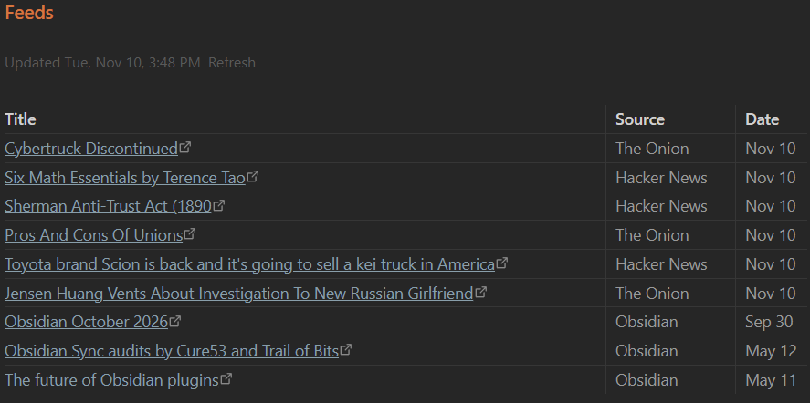

# Inline RSS

Show the latest posts from RSS and Atom feeds as a table inside any note: a home page, a daily note, a project dashboard, anywhere.

## Installation

From Obsidian:

1. Open **Settings → Community plugins** and turn off **Restricted mode** if it is on.
2. Select **Browse**, search for **Inline RSS**, then select **Install**.
3. Select **Enable**.

Manually:

1. Download `main.js`, `manifest.json` and `styles.css` from the [latest release](https://github.com/ChandlerCGray/obsidian-inline-rss/releases/latest).
2. Put them in `<your vault>/.obsidian/plugins/inline-rss/`.
3. Reload Obsidian, then enable **Inline RSS** under **Settings → Community plugins**.

## Usage

Add an `inline-rss` code block to any note, with one feed per line. Options are optional.

````
```inline-rss
max: 15
per-feed: 3
refresh: 30
Hacker News | https://hnrss.org/frontpage
Obsidian | https://obsidian.md/feed.xml
The Onion | https://theonion.com/feed/
```
````

Renders as a table of **Title / Source / Date**, newest first, with an "Updated …" line and a **Refresh** link.



## Options

| Line | Default | Meaning |
| --- | --- | --- |
| `max: N` | 15 | Total rows in the table |
| `per-feed: N` | 3 | Most rows taken from any one feed |
| `refresh: N` | 30 | Minutes before a feed is fetched again |
| `Name \| URL` | | A feed. The name shows in the Source column. A bare URL also works. |
| `// text` | | Comment, ignored |

## Notes

- Supports RSS 2.0, RSS 1.0 (RDF) and Atom.
- Feeds refresh while Obsidian is open, on the **Refresh** link, or with the **Inline RSS: Refresh feeds** command.
- Results are cached in the plugin's own `data.json` so the table shows instantly on startup. Nothing is written to your notes.
- Network use: the plugin requests only the feed URLs you list in your notes. No other requests, no telemetry.

## Support

This plugin is provided as-is and is intentionally minimal. Issues and PRs may not get a response. Fork freely.

## License

MIT
